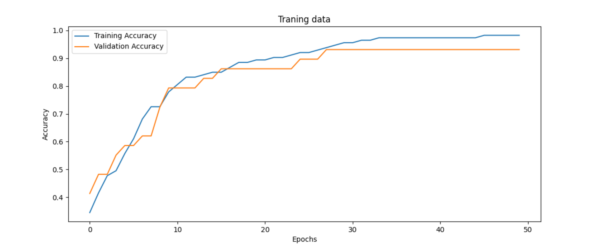
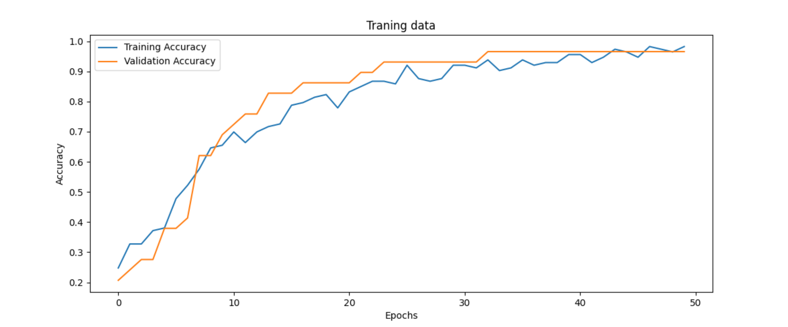

1. Opis modeli

Model 1
- Inuput (13) 
- Dense(10, activation="relu")
- Dense(3, activation="softmax")

Model 2
- Inuput (13) 
- Dense(16, activation="tanh", kernel_initializer="lecun_uniform, name="hidden_layer_one")
- Dropout(0.3, name="dropout")
- Dense(8, activation="relu", kernel_initializer="he_normal", name="hiddwen_layer_two")
- Dense(3, activation="softmax", name="Output")

Paramtery: 
- Optimizer: Adam(lr=default(0.001))
- Epochs: 50
- Batch_size: 15 

2. Krzywe uczenia

Model 1

Dokładność: 94% - model szybko osiąga wysoką dokładność, bez większych wachań, strata: 0.2208

Model 2

Dokładność: 97% - model szybciej osiąga wysoką dokładność, ale ma większe wachania, strata: 0.1070

3. Wnioski

Model 2 osiągnął większą dokładność od modelu 1 w klasyfikacji win
Oba modele są zdolne do identyfikacji wina z wysoką dokładnością